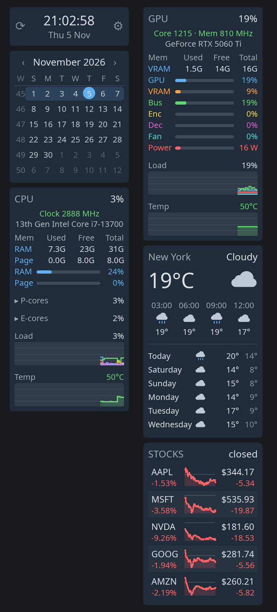
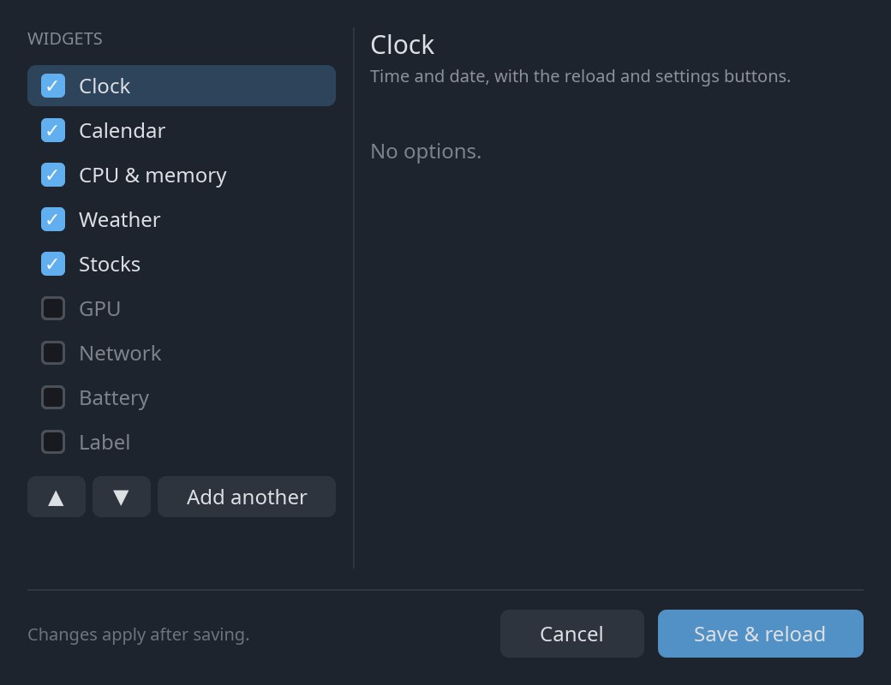

# sidebar

A desktop sidebar of system and information widgets for Linux and Windows,
written in Rust. Widgets dock to any edge of any monitor, can be dragged between edges
or left floating, and are configured from a settings window or a TOML file.



- **Widgets:** clock, calendar, CPU (per-core load, P-/E-cores, temperature,
  RAM and swap), NVIDIA GPU, network, weather, stock quotes, battery, text
  label.
- **Drag and drop:** drag any widget to another screen edge, between other
  widgets, or into the middle of the screen. Placements are remembered.
- **Settings window:** turn widgets on and off, reorder them, and edit their
  options without touching the config file.
- **Light:** one small binary with no dependencies beyond the operating
  system. It draws everything itself, without a GUI toolkit or a web view.
- **Private by default:** nothing is sent anywhere unless you turn on the
  weather or stocks widgets (see [Privacy](#privacy)).

> **Status:** early (0.1). Developed and used on GNOME (through XWayland)
> and X11. The Wayland backend works on compositors with layer-shell but has
> had less testing. The Windows backend is new and has been tested on
> Windows 11; there are no prebuilt binaries yet.

## Platform support

| Environment | Backend | Notes |
|---|---|---|
| X11 (any EWMH window manager) | `x11` | Full support, including the settings window and reserving screen space. |
| GNOME on Wayland | `x11` through XWayland | Chosen automatically, because GNOME has no layer-shell. GNOME ignores reserved space here, so windows can cover the sidebar. |
| KDE Plasma, Sway, Hyprland, COSMIC, river, labwc, niri | `wayland` | Docks use the layer-shell protocol. Widgets can't float, and ⚙ opens the config file instead of the settings window. |
| Windows 10 and 11 | `windows` | Full support. Docks reserve space like the taskbar does (as an AppBar). |
| macOS | – | Not supported yet. |

## Install

You need Rust 1.88 or newer ([rustup.rs](https://rustup.rs)). No other
libraries or packages are required to build it.

```sh
git clone https://github.com/cksandal/sidebar.git
cd sidebar
cargo install --path crates/sidebar-app --locked
```

This installs the `sidebar` binary to `~/.cargo/bin`. Run `sidebar` to start
it.

On Windows, the same commands work in a terminal once Rust is installed
with rustup's default (MSVC) toolchain, which needs the Visual Studio C++
Build Tools. Run `sidebar.exe` from a terminal, because for now it keeps a
console window open. Building a Windows binary on Linux is described in
[CONTRIBUTING.md](CONTRIBUTING.md#windows).

Optional extras:

- **NVIDIA GPU widget:** needs the NVIDIA driver, which provides
  `libnvidia-ml.so.1` (`nvml.dll` on Windows). Without it, the GPU widget is
  skipped.
- **Wi-Fi network name and link speed (Linux):** read with `iw` if it is
  installed. Without it, the network widget still shows addresses, signal
  and traffic. Windows reports these itself.

### Start at login

Most Linux desktops start programs listed in `~/.config/autostart`. Copy the
included entry there and point it at the installed binary:

```sh
mkdir -p ~/.config/autostart
sed "s|^Exec=.*|Exec=$HOME/.cargo/bin/sidebar|" packaging/sidebar.desktop > ~/.config/autostart/sidebar.desktop
```

On Windows, press Win+R, enter `shell:startup`, and put a shortcut to
`sidebar.exe` in the folder that opens.

## Using it

- **Move a widget:** press and drag it.
  - Drop it near a screen edge to dock it there, or between two docked
    widgets to insert it.
  - Drop it anywhere else to leave it floating.
  - Right-click while dragging to cancel.
- **⟳ (left of the clock):** reloads. The sidebar restarts and re-reads its
  configuration.
- **⚙ (right of the clock):** opens the settings window.
- **Calendar:** click ‹ or › to change month, and click the month name to
  return to today.
- **CPU widget:** on CPUs with performance and efficiency cores, click
  **P-cores** or **E-cores** to show or hide the per-core bars.

### Settings window



- **General:** whether the sidebar reserves its screen edge (maximized
  windows stop at it), whether it stays on top of other windows, the edge
  new widgets dock to, and the background opacity. Settings your desktop
  can't apply are grayed out, with the reason: reserving space under
  XWayland, and opacity on X11 without a compositor.
- **Widget list:**
  - Tick or untick a widget to show or hide it.
  - **▲** and **▼** change the order.
  - **Add another** adds a second copy of the selected widget, for example
    weather for a second city.
- **Options:** the right side shows the selected widget's options.
- **Save & reload** writes your changes to the config file and restarts the
  sidebar.
- **Keyboard:**
  - **↑**/**↓** select a widget.
  - **Space** ticks or unticks it.
  - Typing edits the selected widget's text field.
  - **Enter** saves, and **Esc** closes the window.

## Configuration

The sidebar reads `~/.config/sidebar/config.toml` (or
`$XDG_CONFIG_HOME/sidebar/config.toml`; `%APPDATA%\sidebar\config.toml` on
Windows). The file is optional; without it you get the clock, CPU, GPU,
network and battery widgets on the right edge.

[`config.example.toml`](config.example.toml) lists every option with its
default. A small example:

```toml
always_on_top = false      # true: stay above other windows

[dock]
edge = "right"             # where new widgets go: left, right, top, bottom
thickness = 160            # dock width in pixels
reserve_space = true       # keep maximized windows out of the dock's strip

[theme]
accent = "#61afef"
opacity = 90               # background opacity in percent; text stays solid

[[widgets]]
type = "clock"

[[widgets]]
type = "weather"
location = "Berlin"        # or "Springfield, Illinois", or "52.52, 13.41"
units = "celsius"

[[widgets]]
type = "stocks"
symbols = ["AAPL", "^GSPC", "EURUSD=X"]
```

Listing any `[[widgets]]` replaces the default set. Misspelled options are
reported as errors rather than silently ignored. Dragged positions are saved
separately in `~/.local/state/sidebar/layout.toml`
(`%LOCALAPPDATA%\sidebar\layout.toml` on Windows); delete that file to reset
them.

### Widgets

| `type` | Shows | Options |
|---|---|---|
| `clock` | Time and date, with the ⟳ and ⚙ buttons | – |
| `calendar` | Month grid with ISO week numbers | `week_start = "sunday"` or `"monday"` |
| `cpu` | Total and per-core load, clock speed, temperature, RAM and swap | – |
| `gpu` | NVIDIA GPU load, memory, encoder and decoder, fan, power, temperature | `index`: which GPU, counting from 0 |
| `network` | Wi-Fi name and signal, IP addresses, gateway, traffic | `interface`, e.g. `"enp4s0"` (default: the one with the default route) |
| `weather` | Current conditions, next hours and next six days | `location` (required), `units = "celsius"` or `"fahrenheit"` |
| `stocks` | Price, daily change and an intraday chart per symbol | `symbols` (required), in Yahoo Finance notation |
| `battery` | Charge level (skipped on machines without a battery) | – |
| `label` | A line of text | `text` (required) |

### Command line

```
sidebar [--backend auto|x11|wayland|windows|headless] [--edge left|right|top|bottom]
        [--config FILE] [--layout FILE] [--settings]
```

`--settings` opens the settings window at start. `sidebar --help` lists all
options, including the ones for testing.

## Privacy

The sidebar sends no telemetry. Only two widgets use the network, and both
are off unless you add them:

- **Weather** sends your configured location (a place name, or coordinates)
  to [Open-Meteo](https://open-meteo.com), whose geocoding and forecast APIs
  are free and need no account. It refreshes every 15 minutes.
- **Stocks** sends the configured ticker symbols to Yahoo Finance every 5
  minutes. This is the unofficial endpoint used by many open-source tools,
  so it may change or be rate-limited. Quotes may be delayed and are for
  information only.

Everything else is read locally: `/proc`, `/sys` and `iw` on Linux, the
system APIs on Windows, and the NVIDIA driver library.

## Troubleshooting

- **Windows cover the sidebar, or maximized windows overlap it.** On GNOME,
  the sidebar runs through XWayland, where GNOME ignores reserved screen
  space. Set `always_on_top = true` to keep it visible.
- **Windows: maximized windows still cover the sidebar.** Check that
  **Reserve screen space** is on in the settings window. Full-screen apps
  (videos, games) cover it on purpose.
- **The sidebar won't move to the other edge.** Check for a GNOME extension
  or window rule that positions windows titled `sidebar`.
- **No GPU widget.** Only NVIDIA GPUs are supported so far, through the
  driver's NVML library. Run `sidebar` from a terminal; skipped widgets are
  reported there.
- **"place not found" in the weather widget.** Add a region or country, as
  in `"Springfield, Illinois"` or `"Paris, France"`, or use coordinates.
- **Stocks show "offline".** Yahoo occasionally rejects requests. The widget
  retries every minute and keeps the last prices it had.
- **Something else.** Run `sidebar` from a terminal to see its messages, and
  please [open an issue](../../issues).

## Contributing

Bug reports and pull requests are welcome. [CONTRIBUTING.md](CONTRIBUTING.md)
covers building, testing and the project's conventions, and
[docs/ARCHITECTURE.md](docs/ARCHITECTURE.md) explains how the code fits
together.

## Roadmap

- Windows: no console window, start at login, prebuilt binaries.
- AMD and Intel GPUs; disk and audio widgets.
- Settings window and floating widgets on Wayland.
- HiDPI scaling on X11; fractional scaling on Wayland.
- Reloading the config automatically when the file changes.

## License

Licensed under either of [Apache License 2.0](LICENSE-APACHE) or
[MIT license](LICENSE-MIT), at your option. Unless you state otherwise, any
contribution you submit for inclusion is dual-licensed the same way, without
additional terms.
